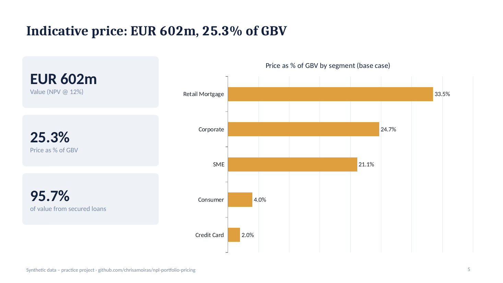
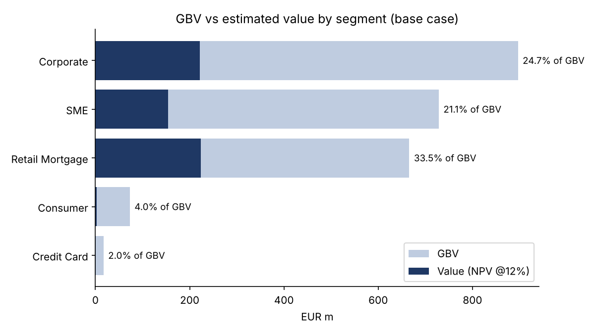
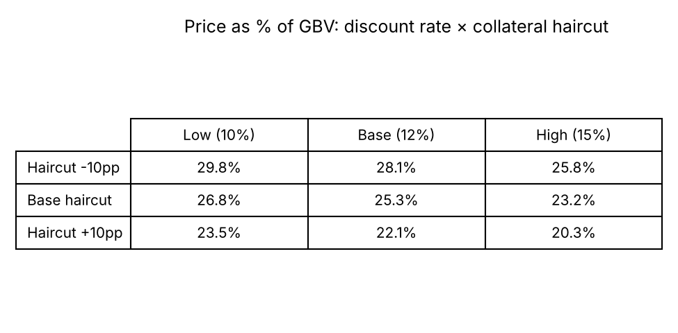

# Greek NPL Portfolio – Due Diligence & Indicative Pricing

> **Synthetic data, for practice only.** The loan tape was generated to look like a Greek non-performing loan (NPL) portfolio. It does not describe any real bank, servicer or borrower.



## Questions
1. What does the portfolio look like (segments, collateral, legal status, LTV, concentration)?
2. **How much would an investor pay for it, in EUR and as % of gross book value (GBV)?**
3. Which parts of the portfolio drive the value, and how sensitive is the price to the key assumptions?

## Data
- `npl_loan_tape.csv`: synthetic loan tape, 20,085 rows × 18 columns, cut-off 30/09/2026. It looks like the data tape a seller sends to bidders: segment, region, GBV (principal + accrued interest), days past due, legal status, collateral type, property value (OMV), lien rank, last-12-month collections.
- Data-quality issues were planted on purpose: duplicates, missing regions, negative property values, inconsistent labels.

## Method
1. **Profiling & cleaning** (`01_profiling_cleaning.ipynb`, Python/pandas)
   - Removed 85 duplicate rows and standardised 15 segment labels.
   - Set 10 negative property values to missing and 60 missing regions to `Unknown`.
   - Flagged 23 secured loans with no valid valuation (`omv_missing`). They are valued as unsecured, which is the conservative choice.
2. **Strats** (`strats.sql`, run on SQLite inside notebook 02): portfolio overview and splits by segment, legal status, LTV bucket, region and top-20 borrower concentration.
3. **Loan-level valuation**, built in both Excel (`NPL_Portfolio_Valuation_Model.xlsx`, ~220k formulas) and Python:
   - Collateral recovery = MIN(GBV, OMV × (1 − haircut) × lien factor). Haircuts are 30% for residential, 40% for commercial and 55% for land property; the lien factor is 1 / 0.5 / 0.2 for 1st / 2nd / 3rd rank.
   - Unsecured recovery is 3–8% of GBV depending on segment. On secured loans it applies at half rate to the uncovered balance.
   - Net collections = gross collections − 8% servicing fee − 3% legal costs on collateral recoveries.
   - NPV = net collections / (1 + r)^years. Years to recovery run from 2 (amicable) to 6 (bankruptcy). The base-case r is 12%, read as the investor's target IRR.
4. **Scenarios**: discount rate (10 / 12 / 15%) × collateral haircut (±10 percentage points).
5. **Cross-check**: Excel and Python give the same total NPV (difference < €0.01, see the `Check` sheet).
6. **Investor summary**: 6 slides in `NPL_Portfolio_Investor_Summary.pdf`.

## Key findings (base case, r = 12%)
| Metric | Value |
|---|---|
| Loans / borrowers | 20,000 / 11,227 |
| GBV | €2,380.8m |
| Secured share of GBV | 73.6% |
| Net expected collections | €882.4m (37.1% of GBV) |
| **Indicative value (NPV)** | **€602.2m = 25.3% of GBV** |

- **Secured loans carry the value.** They are 73.6% of GBV but 95.7% of the price (32.9% of their GBV). Unsecured loans are worth only 4.1% of GBV.
- **Value by segment, as % of GBV:** Retail Mortgage 33.5%, Corporate 24.7%, SME 21.1%, Consumer 4.0%, Credit Card 2.0%. Mortgages and Corporate each account for about 37% of the total value.
- **Collateral cover is thin.** 57% of secured GBV has LTV above 100%, meaning the debt is larger than the property value, so the collateral caps recoveries.
- **Legal status matters.** 47.2% of GBV is denounced. Loans in bankruptcy/insolvency are worth only 18.2% of GBV because of the long resolution time, against about 30% for amicable cases and cases at auction.
- **Price range is 20.3%–29.8% of GBV** across the scenarios. A 10-point change in the haircut moves the price by about 3 points, roughly as much as moving the target IRR from 10% to 15%.




## Limitations
- The data are synthetic and the assumptions are illustrative, not market benchmarks.
- Each loan has a single cash flow at its expected resolution year. A real model would use monthly collection curves, servicer fees on a schedule, and borrower-level (not loan-level) workout.
- Property values are taken as given. 76% of valuations are more than two years old, so a real due diligence would re-value the largest exposures.
- The model does not cover REO, taxes, funding/leverage or the structure of a securitisation (for example, Hercules senior/mezzanine notes).

## SQL queries
`strats.sql`: portfolio overview, strats by segment / legal status / LTV bucket (CTE + CASE), top-10 regions, and top-20 borrower concentration (CTE + subquery).

## Repository structure
All files are in the repository root:
```
npl-portfolio-pricing/
├── README.md
├── npl_loan_tape.csv            # raw synthetic tape (with planted issues)
├── npl_loan_tape_clean.csv      # output of notebook 01
├── loan_level_valuation_base.csv # loan-level results, base case (notebook 02)
├── 01_profiling_cleaning.ipynb
├── 02_strats_valuation.ipynb
├── strats.sql
├── NPL_Portfolio_Valuation_Model.xlsx
├── NPL_Portfolio_Investor_Summary.pdf
├── NPL_Portfolio_Investor_Summary.pptx
├── investor_summary_price_slide.png
├── gbv_vs_value_by_segment.png
├── scenario_grid.png
└── gbv_by_ltv.png
```

**Tools:** Python (pandas, matplotlib, sqlite3), SQL, Microsoft Excel (VLOOKUP, SUMIF, SUMPRODUCT, named ranges, scenario grid), PowerPoint.

*Author: Christos Amoiras · BSc Statistics (AUEB) · [github.com/chrisamoiras](https://github.com/chrisamoiras)*
